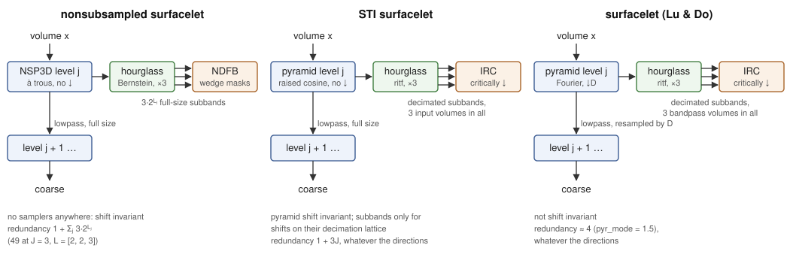

# [Theory](@id theory)

```@meta
CurrentModule = Surfacelets
```

This page covers the three surfacelet transforms and the stages they share.



The surfacelet transform is a construction in its own right rather than a
contourlet transform with an extra axis.  Its directional stage carves the
spectrum into hourglass-shaped regions around the three frequency axes — from
Bernstein mapping kernels in the nonsubsampled transform, from SurfBox's
diamond kernels in the other two — a partition with no separable-lattice
description, so there is no quincunx lattice, no shear index remap and no ladder
filter anywhere in it.  Lu and Do prove that the *hourglass* partition — the
first stage, which splits the spectrum into ``N`` hourglasses around the
frequency axes — cannot be achieved by a critically sampled filter bank above
two dimensions, so that stage has an unavoidable redundancy of ``N``.  The
wedge refinement after it can be critically sampled in their construction,
which is why the paper's surfacelet transform reaches a redundancy of about
``N + 1`` overall.  The decimated transform here follows that construction (see
[Iterated resampled checkerboard filter banks (IRC)](@ref)); the nonsubsampled
one keeps every subband at full size instead.

## Nonsubsampled pyramid (NSP3D)

The multiscale stage is the direct extension of the 2-D à trous pyramid.  At
level ``j`` the filters are upsampled by ``2^{j-1}`` along each axis and nothing
is decimated:

```
coarse   = h_j ⊛ volume
bandpass = volume − g_j ⊛ coarse
```

The synthesis rescale `_NSP_SYNTH_SCALE` is applied **per axis**, so the 2-D
constant carries over unchanged.  This is worth stating explicitly because the
obvious guess is wrong in an instructive way: the biorthogonal synthesis ``g``
has DC gain 2 per axis, giving ``2^3 = 8`` across a separable 3-D filtering, and
one might expect the correction to become ``1/8``.  It does not — the ``1/2``
applies once per axis, and ``(1/2)^3`` is exactly the ``1/8`` needed.  A wrong
normalisation here does not break perfect reconstruction, it merely fills the
"bandpass" with low-pass leakage, which is why the test suite checks that a
constant volume leaves the bandpass at zero.

All filtering is periodic, so the stage is exactly equivariant under circular
shifts and — since periodic separable filtering *is* circular convolution — an
FFT evaluation of it is exact rather than approximate.  See
[`conv3d_sep_fft!`](@ref).

## Hourglass filter bank

The directional stage starts by splitting the spectrum into three
hourglass-shaped subbands, each aligned with one frequency axis:

```math
P_i = \{\omega : |\omega_i| \ge |\omega_j| \ \text{for all } j \ne i\}
```

so subband ``i`` keeps the frequencies closer to axis ``i`` than to any other.

The design follows Lu and Do's mapping-based construction.  One-dimensional
polynomials ``f_0, f_1`` are composed with a multidimensional *mapping kernel*
``M(\omega)`` — a zero-phase FIR filter designed so that ``M \approx +1`` on the
desired passband and ``\approx -1`` outside it — giving multidimensional filters
``f_0(M(\omega))`` and ``f_1(M(\omega))`` that inherit both the FIR property and
the perfect-reconstruction relation between ``f_0`` and ``f_1``.

The kernels come from multivariate Bernstein polynomials under the change of
variables ``x_i = (1 - \cos\omega_i)/2``, which maps ``|\omega_i|`` monotonically
onto ``[0, 1]``.  That is the reason the construction is tractable: an hourglass
passband is a statement about the *ordering* of frequency magnitudes, and after
the change of variables it becomes the same ordering statement about the integer
Bernstein sample indices — see [`mapping_coefficients`](@ref).

Three subbands are produced by a cascade of two two-channel banks:

```
spectrum ──┬─ P₁                             (3-D mapping kernel)
           └─ P₂ ∪ P₃ ──┬─ P₂                (2-D kernel on ω₂, ω₃)
                        └─ P₃
```

The second stage needs only two frequency variables.  That is not an
optimisation but a theorem: Lu and Do's Proposition 1 shows the optimal passband
support for a tree node with index set ``J`` involves ``|J|`` frequency
variables, so in 3-D the second cut is a 2-D design.

The partition is easiest to see on planes of the frequency cube.  The figure
colours every frequency by the hourglass whose weight is largest there (the
counterpart of the hourglass partition figures in Lu and Do's papers), on the
plane ``\omega_3 = 0`` and on a plane ``\omega_3 = 3\pi/8`` cutting through all
three:

```@setup theory
using Surfacelets, Plots
Plots.default(show = false)

# The banks store masks on the rfft grid (non-negative ω₁ only).  A real mask is
# even, W(-ω) = W(ω), so the other half of a plane ω₃ = k₃ is read off the
# mirrored bin.  Rows are ω₁, columns ω₂, both from -π to π.
function fullplane(W::AbstractArray{<:Real, 3}, k3::Int)
    n2, n3 = size(W, 2), size(W, 3)
    bin(k, n) = mod(k, n) + 1
    return [
        a >= 0 ? W[a + 1, bin(b, n2), bin(k3, n3)] : W[-a + 1, bin(-b, n2), bin(-k3, n3)]
            for a in (-n2 ÷ 2):(n2 ÷ 2 - 1), b in (-n2 ÷ 2):(n2 ÷ 2 - 1)
    ]
end

dominant(planes) = map(I -> argmax([P[I] for P in planes]), CartesianIndices(first(planes)))
```

```@example theory
n  = 64
hg = make_hourglass((n, n, n), Float64; order = 12)
w  = [hourglass_weight(hg, i) for i in 1:3]
f  = ((-n ÷ 2):(n ÷ 2 - 1)) ./ (n ÷ 2)          # frequency in units of π

colors = cgrad(:tab10, 3; categorical = true)
panel(k3, title) = heatmap(
    f, f, permutedims(dominant([fullplane(w[i], k3) for i in 1:3]));
    color = colors, clims = (0.5, 3.5),
    aspect_ratio = :equal, xlabel = "ω₁/π", ylabel = "ω₂/π", title = title,
    colorbar = false, xlims = (-1, 1), ylims = (-1, 1)
)
# A frameless third panel of invisible markers carries the legend.
key = plot(; framestyle = :none, legend = :left, legendfontsize = 10,
    foreground_color_legend = nothing, legendtitle = "hourglass")
for i in 1:3
    scatter!(key, [NaN], [NaN]; color = colors[i], markerstrokewidth = 0, markersize = 8,
        label = "$i: |ω$(('₁', '₂', '₃')[i])| largest")
end
plot(panel(0, "ω₃ = 0"), panel(12, "ω₃ = 3π/8"), key;
    layout = @layout([a b c{0.2w}]), size = (1000, 400), left_margin = 4Plots.mm)
savefig("hourglass_partition.png"); nothing # hide
```


On ``\omega_3 = 0`` only the first two hourglasses appear — the bow tie around
``\omega_1`` and the one around ``\omega_2``; the third is the set where
``|\omega_3|`` dominates, so off that plane it fills the central square around
the origin, which grows with ``|\omega_3|``.

### Two deviations from the reference construction

**Frequency domain rather than FIR.**  This deviates from the hourglass filter
bank paper, not from the surfacelet paper: the original surfacelet transform and
SurfBox are themselves FFT-based, and Lu and Do moved to FIR spatial filters
later because the frequency-domain design needed too much memory for streaming
video.  That trade-off inverts here.  These stages are nonsubsampled
with a periodic boundary, so the FFT is already the default backend, and
evaluating the mapping kernel directly on the DFT grid is *exact* — there is no
truncation of the FIR filters the paper reports (supports of 37³ for the
first stage and up to 25×61×61 for the second).

**A partition of unity, normalised into a Parseval frame.**  The 1-D
polynomials used here satisfy ``f_0(x) + f_1(x) = 1`` identically, so the three
*weights* ``W_k`` sum to 1 at every frequency, for every choice of `order` and
`poly`.  What the filters do with that partition is the `tight` setting of
[`make_hourglass`](@ref):

  * `tight = false` — the masks are the weights themselves.  The synthesis
    filters are all 1 and reconstruction is a plain sum, with no transforms at
    all.  But ``\sum_k W_k^2`` ranges over ``[1/3, 1]``, so the bank is a frame
    with bound ratio 3: analysis does not preserve energy, and white noise
    arrives with subband-dependent variance.

  * `tight = true` (the default) — the masks are ``\sqrt{W_k}``, the pointwise
    normalisation SurfBox uses.  Then ``\sum_k (\sqrt{W_k})^2 = \sum_k W_k = 1``
    identically: a Parseval frame, ``\sum_k \|s_k\|^2 = \|x\|^2``, with the
    analysis adjoint as its own inverse.  Synthesis reapplies the masks, so it
    costs a forward transform per subband plus one inverse rather than a bare
    sum.

The price is smaller than the extra transforms suggest, because the pyramid
dominates the nonsubsampled transform.  At 128³ `Float32` with `J = 2`, `L = [2, 2]` and 8 FFTW
threads: the directional inverse costs 0.294 s tight against 0.096 s loose
(3.1×), but the full round trip only moves from 0.66 s to 0.76 s (1.15×).

Both are exact.  SurfBox normalises to ``\sum_k V_k^2 = N`` rather than 1 — the
same construction up to the constant ``\sqrt{N}`` — and
`test/items/test_surfbox_reference.jl` checks both against it.  Whichever
setting is in use, the deviation from Lu and Do's optimised lifting/ladder
coefficients costs nothing in frame conditioning; the pointwise normalisation
reaches tightness on its own.

The normalisation exposes a constraint the plain-sum path hides: each mask must
be **even** in frequency, or the masked spectrum is not Hermitian and the real
subband is a lossy record of it.  A plain sum never notices, since the
individual asymmetries cancel before the inverse transform.  See
"[A sign trap on the DFT grid](@ref sign-trap)" below — the same trap, in the same place,
for the same reason.

`order` (the Bernstein order ``N``) controls how sharply the subbands separate.
Larger ``N`` converges to the ideal indicator; the deviation from it falls
monotonically, from about 0.095 mean absolute error at ``N = 4`` to 0.024 at
``N = 20``.

## Directional filter bank (NDFB)

Each hourglass is then refined into wedges.  Inside ``P_i`` the two transverse
ratios

```math
s = \omega_a / \omega_i \in [-1, 1], \qquad t = \omega_b / \omega_i \in [-1, 1]
```

parameterise direction, and ``l`` levels of refinement cut each into ``2^l``
equal slabs.  With ``l_a + l_b = L`` this gives ``2^L`` wedges per hourglass and
``3 \cdot 2^L`` directional subbands in total, whose ideal passbands are
rectangular-based pyramids radiating from the origin.

Both ratios are invariant under ``\omega \to -\omega``, so the masks stay
symmetric and a real volume keeps real subbands.  Each ratio involves only two
frequency axes, so a wedge mask is a *matrix*: the whole bank stores
``2(2^{l_a} + 2^{l_b})`` planes no matter how large the volume is.

Lu and Do build these wedges from a chain of iteratively resampled checkerboard
filter banks, because their transform is critically sampled inside each
hourglass and the resampling is what keeps it so.  This bank is nonsubsampled,
so there is nothing to resample for and the wedge boundaries are placed directly
in the frequency domain.  The ideal partition is the same one.  Constructing it
directly also avoids the failure mode that a separable approximation invites:
filtering the transverse directions with 1-D filters produces stripe and block
tilings of the frequency plane, not wedges, and the resulting transform is still
perfectly reconstructing — so perfect reconstruction alone does not detect the
error.  The test suite therefore checks the wedge *index* a plane wave lands in,
not merely that some subband is large.

The same plane ``\omega_3 = 0`` at ``L = 4`` (``l_a = l_b = 2``), coloured by
the subband of largest weight, shows the fan of wedges each hourglass is cut
into — four per hourglass on this plane, since ``\omega_3 = 0`` fixes the second
transverse ratio:

```@example theory
fb = make_ndfb((n, n, n), Float64; levels = 4, order = 12)
wk = [fullplane(ndfb_weight(fb, k), 0) for k in 1:ndfb_nsubbands(fb)]
heatmap(f, f, permutedims(dominant(wk)); color = :turbo, aspect_ratio = :equal,
    xlabel = "ω₁/π", ylabel = "ω₂/π", title = "dominant NDFB subband, ω₃ = 0",
    colorbar_title = "subband index", size = (460, 400))
savefig("ndfb_wedges.png"); nothing # hide
```


In three dimensions one subband's support is a pair of opposite
rectangular-based pyramids with their apex at the origin — the shape Lu and Do
draw for the surfacelet frequency support.  The frequencies where one subband of
a ``L = 2`` bank carries more than half the weight:

```@example theory
m   = 32
fb2 = make_ndfb((m, m, m), Float64; levels = 2, order = 12)
W   = ndfb_weight(fb2, 1)                     # hourglass 1, wedge (1, 1)
fold(k, len) = (k - 1 <= len ÷ 2 ? k - 1 : k - 1 - len) / (len ÷ 2)
pts = [
    (fold(a, m), fold(b, m), fold(c, m))
        for c in 1:m, b in 1:m, a in 1:size(W, 1) if W[a, b, c] > 0.5
]
pts = vcat(pts, [(-x, -y, -z) for (x, y, z) in pts])   # W(-ω) = W(ω)
scatter3d(first.(pts), getindex.(pts, 2), last.(pts); markersize = 1.5,
    markerstrokewidth = 0, legend = false, xlims = (-1, 1), ylims = (-1, 1),
    zlims = (-1, 1), xlabel = "ω₁/π", ylabel = "ω₂/π", zlabel = "ω₃/π",
    title = "support of one directional subband", size = (480, 440))
savefig("ndfb_support.png"); nothing # hide
```


## Nonsubsampled surfacelet transform

Composing the two stages gives the transform:

```
volume ─ NSP3D ─┬─ coarse ─→ next scale
               └─ bandpass ─ NDFB ─→ 3·2^L directional subbands
```

Every coefficient array keeps the size of the input, so the transform is exactly
shift-invariant — and correspondingly redundant: ``1 + \sum_j 3 \cdot 2^{L_j}``
copies of the input.  For ``J = 3`` and ``L = [2, 2, 3]`` that is 49 volumes,
3.1 GB at 256³ `Float32`.  The streaming form of [`ns_surfacelet_forward`](@ref) exists
for this reason: it holds one subband at a time.

Because the directional bank depends only on the volume size and never on the
scale, a workspace plans the hourglass mapping response once and shares it
across every scale, with only the (matrix-sized) wedge masks differing.

## Running on a GPU

The 3-D stack needs no device kernels.  Both transforms are FFT plus a pointwise
mask, and every mask is stored as broadcastable factors — the mapping responses
and wedge planes are 3-D arrays with singleton axes where they do not depend on
a frequency — so applying a mask, splitting a complex volume into real and
imaginary halves, and the pyramid's frequency-domain multiply are all plain
broadcasts.  Moving a plan to the device is therefore just moving its arrays and
replanning the transforms:

```julia
using CUDA, Adapt, Surfacelets
using CUDA: CuArray
import Adapt

params = NSSurfaceletParams(J = 2, L_array = [2, 2])
ws = Adapt.adapt(CuArray, make_ns_surfacelet_workspace(params, (128, 128, 128), Float32))
c  = ns_surfacelet_forward(CuArray(vol), params; workspace = ws)
```

A workspace adapt moves the shared hourglass response once, not once per scale.
Verified against the CPU path on CUDA and OpenCL.

The decimated surfacelet transform follows the same rule: the pyramid is a
broadcast against its separable profile plus a crop through index views, the
hourglass stage a broadcast against precomputed masks, and each IRC stage a
broadcast between the two halves of a reshaped view.  Its plan is built on the
host — the checkerboard filter slices are evaluated point by point in closed
form — and then adapted to the *bare* array type (`Adapt.adapt(CuArray, pl)`,
never `typeof(x)`, since the plan holds real, complex and integer tables).  The
STI transform reuses the same plan pieces.  Both are verified against the CPU
path on CUDA (an A100).  A device volume with no plan is an `ArgumentError`, not
an implicit rebuild.

## Surfacelet transform (decimated)

The nonsubsampled transform buys exact shift invariance with redundancy.  The surfacelet
transform trades the invariance back for a coefficient set about 4 times the
input, which is what makes it usable as a sparsifying transform rather than only
as an analysis tool.  It is Lu and Do's construction (TIP 2007, Section VI), as
implemented by their reference toolbox SurfBox — and it reproduces SurfBox's
coefficients to rounding error.  Three stages, all in the frequency domain:

```
spectrum ─ pyramid ─┬─ bandpass ─ hourglass (×3) ─ IRC ─→ wedges, decimated
                    └─ lowpass (resampled by D) ─ … ─→ coarse
```

### Multiscale pyramid

One level splits a spectrum ``X`` with a separable lowpass ``L(\omega)``, a
product of 1-D raised-cosine ramps that is 1 for ``|\omega_d| \le \pi(w - t)``
and 0 beyond ``\pi(w + t)``:

```math
\text{lowpass} = \mathrm{crop}_{n/D}\big(L X\big) / D^{N/2}, \qquad
\text{highpass} = \sqrt{1 - L^2}\, X .
```

Because ``L`` vanishes before ``\pi/D``, cropping the spectrum to ``n/D`` bins is
an exact, alias-free downsampling — even by the non-integer factor ``D = 3/2`` —
and ``L^2 + (1 - L^2) = 1`` makes every level tight.  The highpass stays at full
resolution and feeds the directional stage.  SurfBox's three modes:

| `pyr_mode` | first level ``(w, t, D)`` | later levels | redundancy (3-D) |
|------------|---------------------------|--------------|------------------|
| 1          | ``(1/2, 1/6, 1)``         | ``(1/4, 1/12, 2)`` | ≈ 6.4 |
| 1.5        | ``(1/2, 1/7, 3/2)``       | ``(3/8, 1/9, 2)``  | ≈ 4.0 |
| 2          | ``(1/3, 1/7, 2)``         | ``(1/3, 1/7, 2)``  | ≈ 3.4 |

### Hourglass stage ("ritf")

A 2-D diamond kernel ``m(k_1, k_2) = w(k_1 + k_2)\, w(k_1 - k_2)``, with ``w`` a
Kaiser-windowed half-band sinc of length `msize`, has a zero-phase response
``D(\omega_a, \omega_b)``.  Raised to the even power ``\lambda`` and shifted by
``\pi`` along one axis it is a two-sided bow tie around that axis, and the
product over the other planes gives the hourglass weight

```math
h_K(\omega) = \prod_{m \ne K} D(\omega_K + \pi, \omega_m)^\lambda, \qquad
V_K = \sqrt{3\, h_K \big/ \textstyle\sum_k h_k},
```

so ``\sum_K V_K^2 = 3`` exactly and synthesis divides by 3: a tight frame of
redundancy 3, the minimum for an hourglass partition above two dimensions.  This
is a different discrete realisation of the hourglass from the Bernstein mapping
kernels the nonsubsampled transform uses; the decimated transform uses
SurfBox's so that it can match it coefficient for coefficient.  Channel ``K``
keeps only the non-negative half of axis ``K``, since its output is real.

### Iterated resampled checkerboard filter banks (IRC)

Inside hourglass ``K``, every other axis ``m`` gets ``l_m`` two-channel
checkerboard stages on the ``(\omega_K, \omega_m)`` planes, each downsampling
axis ``m`` by 2.  At stage ``\ell`` axis ``m`` is cut into blocks of
``b = n_m / 2^\ell`` bins; each pair of neighbouring blocks is one subband of the
previous stage, and downsampling folds the pair, ``F_c(A)A + F_c(B)B``, into
channel ``c``'s half.  The resampling that keeps the iteration on the wedge is
folded into the filters: the ``g``-th subband of the previous stage uses the
checkerboard filter sheared by ``s = 2^{\ell-1} - 1 - 2g``,

```math
H_c^{(s)}(\omega_K, \omega_m) = H_c(\omega_K,\; \omega_m + s\,\omega_K),
```

sampled on that subband's own ``2b``-point grid (Proposition 2 of the paper:
this is the wedge refinement condition).  Every step is real filtering plus
rectangular downsampling along axes other than ``K``, so each final block is the
half-spectrum of a real subband of size ``n_K \times n_m/2^{l_m} \times
n_{m'}/2^{l_{m'}}`` — exactly ``n_K n_m n_{m'}`` coefficients per hourglass,
however finely it is cut.  That is the whole reason the redundancy does not grow
with the direction count.

The checkerboard filters are Phoong-type ladder filters built from a single 1-D
odd filter ``t``.  With ``b(\omega) = 2\sum_{q\ \mathrm{odd}>0} t_q \sin(q\omega)``
and ``B = -b(\omega_K)\, b(\omega_m)``,

```math
H_0 = \tfrac{1}{\sqrt2}(1 + B), \quad
H_1 = \tfrac{e^{j\omega_m}}{\sqrt2}(2 - B - B^2), \quad
G_0 = \tfrac{1}{\sqrt2}(2 + B - B^2), \quad
G_1 = \tfrac{e^{-j\omega_m}}{\sqrt2}(1 - B),
```

and since ``t`` has only odd taps, ``B(\omega + \pi e_m) = -B(\omega)``, which
gives ``H_0 G_0 + H_1 G_1 = 2`` with the alias term cancelling: perfect
reconstruction.  The bank is biorthogonal, not orthogonal, so the transform is
a frame with exact reconstruction whose inverse is not its adjoint.  These
closed forms reproduce the 2-D filters SurfBox ships (`cbd_filters_<bo>`, orders
4 to 18) to ``10^{-15}``, so the package stores 44 numbers instead of their
roughly 40 000 taps — and, evaluated directly on the frequency grid, they work at
any block size, where SurfBox refuses a block narrower than its spatial filter.

## Semi-translation-invariant (STI) surfacelet transform

[`sti_surfacelet_forward`](@ref) keeps the directional stage of the decimated
transform — ritf hourglass and IRC at every scale — but replaces its resampled
pyramid with a nonsubsampled one: SurfBox's mode-1 band edges without the crops.
Level ``j`` uses the separable raised-cosine lowpass ``\ell_j`` with cutoff
``w_j = 2^{-j}`` and transition ``w_j/3`` (in units of ``\pi``) on the original
grid, and

```math
b_j = \sqrt{1 - \ell_j^2}\, \prod_{i<j} \ell_i, \qquad
c = \prod_i \ell_i, \qquad
\sum_j b_j^2 + c^2 = 1,
```

so the pyramid is a tight frame of pointwise frequency weights and commutes with
every circular shift.  Each bandpass is a full-size volume, the IRC stage
decimates it critically inside each hourglass, and the redundancy is exactly
``1 + 3J``.  A directional subband of hourglass ``K`` is sampled on the lattice
``\mathrm{diag}(1, 2^{l_m}, 2^{l_{m'}})`` (Proposition 1 of the paper), so the
transform is equivariant to shifts on that lattice, not to every shift.

The name comes from the structure it shares with Eslami and Radha's
semi-translation-invariant contourlet transform (STICT): a nonsubsampled,
shift-invariant pyramid followed by a critically sampled directional stage.  It
is not a 3-D STICT.  The STICT's pyramid is the translation-invariant Laplacian
pyramid — the decimated Laplacian pyramid's polyphase channels for every lattice
shift, four highpass channels per level, keeping that pyramid's aliasing.  This
transform has one raised-cosine bandpass per scale (SurfBox's mode-1 band edges
without the resampling) and Lu and Do's IRC directional stage.

Neither Lu and Do's papers nor any later paper we know of describes this 3-D
construction.  It composes two published stages, each validated separately: the
directional stage against SurfBox, the pyramid by its tight-frame identity
above.

## [A sign trap on the DFT grid](@id sign-trap)

On the DFT grid, ``\omega \to -\omega`` is *not* a sign flip of the folded
frequency: at the Nyquist bin of an even-length axis ``\pi \equiv -\pi`` maps to
itself.  A sign-sensitive quantity like the wedge ratio ``\omega_2/\omega_1`` of
the nonsubsampled NDFB therefore comes out with opposite signs at two bins that
are each other's negation, which makes a masked spectrum non-Hermitian.

That trap bit `ndfb`, and stayed invisible for a while.  With the masks
applied once and reconstruction a plain sum, the individual asymmetries cancel
before any inverse transform: ``\sum_k W_k X = X`` whatever each ``W_k`` does at
Nyquist, so perfect reconstruction held while the masks were not even.  Turning
on `tight` makes synthesis reapply the masks, which requires each subband to
survive an `irfft`/`rfft` round trip, which requires the mask to be even on the
two self-conjugate planes of the rfft grid.  It was not, and reconstruction
failed by 0.27.

`_wedge_ratio` fixes the sign from the first coordinate that can carry one:
``\omega_\mathrm{ref}`` when it is neither 0 nor ``\pi``, and
``\omega_\mathrm{tr}`` otherwise.  Each factor canonicalises its own plane
independently, so the masks stay separable — the property the GPU path depends
on — and `ndfb — masks are even in frequency` pins the result.

## What has been checked against SurfBox

SurfBox (MATLAB File Exchange submission 14485) is the reference for both
transforms, and `test/reference/` holds golden data from it together with the
MATLAB scripts that regenerate it.

**The decimated transform is checked coefficient for coefficient**
(`test/items/test_irc.jl`, data from `gen_surfbox_irc.m`), stage by stage: the
checkerboard filters of orders 4, 8 and 12, the ritf hourglass masks, the IRC
output of every hourglass at two level matrices, the spatial NDFB subbands and
their reconstruction, the pyramid in all three modes, and `Surfdec` / `Surfrec`
end to end at 48³ (mode 1.5) and 64³ (mode 2).  All agree to about
``10^{-13}`` of the array norm.  The redundancy matches SurfBox's own count at
96³: 4.0046 with 24 subbands per scale over three scales and 3.9259 with 96 over
two — flat in the direction count, against 15–46 for the axis-aligned support
boxes this transform used before IRC.

**The nonsubsampled transform is checked on its partition**
(`test/items/test_surfbox_reference.jl`), since its Bernstein hourglass is a
deliberately different realisation.  What the comparison establishes:

  * The tight normalisation matches.  SurfBox's masks satisfy
    ``\sum_k V_k^2 = 3`` to machine precision; this package's satisfy
    ``\sum_k V_k^2 = 1``, the same construction scaled by ``\sqrt{3}``.
  * The hourglass geometry agrees.  Over a 32³ grid the two constructions pick
    the same dominant hourglass at 94.6% of frequencies, with a mean absolute
    weight difference of 0.037; every disagreement is a near-tie in the
    reference (median gap 0.005 between the top two weights, against 0.887
    averaged over all frequencies), so the two differ only in how they round the
    transition bands.
  * The wedge partition agrees.  Across 80 plane waves at 12 directional
    subbands, the confusion matrix between SurfBox's subband labels and this
    package's is a bijection, 84% of directions match exactly under it, and for
    *every* one of the 80 the reference's subband is this package's first or
    second choice by energy.  This is the check that matters, because perfect
    reconstruction alone would pass for any structurally-PR bank, including one
    with the wrong tiling.

For the nonsubsampled transform that is as far as the comparison can go: its
hourglass composes Bernstein mapping polynomials where SurfBox raises a diamond
kernel's response to a power, and its wedges are directly-placed frequency
boundaries rather than a resampled checkerboard chain.  Same ideal partition,
different discrete realisation.

## References

1. Y. M. Lu and M. N. Do, "Multidimensional Directional Filter Banks and
   Surfacelets", *IEEE Transactions on Image Processing*, 16(4):918–931, 2007.
2. Y. M. Lu and M. N. Do, "A Mapping-Based Design for Nonsubsampled Hourglass
   Filter Banks in Arbitrary Dimensions", *IEEE Transactions on Signal
   Processing*, 56(4):1466–1478, 2008.
3. G. G. Lorentz, *Bernstein Polynomials*, 2nd ed., Chelsea, 1986 — the
   multivariate Bernstein approximation behind the mapping kernels.
4. A. L. da Cunha, J. Zhou, and M. N. Do, "The Nonsubsampled Contourlet
   Transform: Theory, Design, and Applications", *IEEE Transactions on Image
   Processing*, 15(10):3089–3101, 2006 — the nonsubsampled pyramid.
5. M. J. Shensa, "The Discrete Wavelet Transform: Wedding the À Trous and
   Mallat Algorithms", *IEEE Transactions on Signal Processing*,
   40(10):2464–2482, 1992.
6. R. Eslami and H. Radha, "Translation-Invariant Contourlet Transform and Its
   Application to Image Denoising", *IEEE Transactions on Image Processing*,
   15(11):3362–3374, 2006 — the STICT, whose structure (nonsubsampled pyramid,
   critically sampled directional stage) the STI surfacelet transform shares.
7. Y. M. Lu and M. N. Do, SurfBox, MATLAB File Exchange 14485 — the reference
   implementation the decimated transform reproduces; its notice is retained
   in `LICENSE`.
